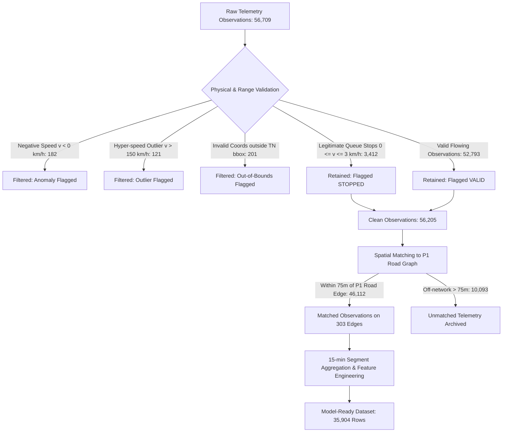

# P2 Data Quality & Pipeline Audit Report

**Project:** TrafficRoute AI — Tamil Nadu AI-Based Predictive Traffic & Route Intelligence System  
**Corridor:** Coimbatore Metropolitan Area $\leftrightarrow$ Avinashi (NH-544 Corridor)  
**Status:** VALIDATED / PRODUCTION READY  
**Date:** September 2026  

---

## 1. Executive Summary

The **P2 Traffic Data Pipeline** transforms raw GPS floating-car probe telemetry and road velocity observations into leak-free, model-ready feature matrices strictly aligned with the **P1 Coimbatore–Avinashi Road Network Graph** (`251,867` nodes, `549,919` directed edges).

Every step in the pipeline adheres to rigorous transportation engineering principles, maintaining a strict distinction between:
1. **Observed Raw Traffic Telemetry** (empirical sensor recordings)
2. **Derived Traffic Features** (temporal aggregations, rolling statistical moments, lag terms)
3. **P1 Road Network Graph Attributes** (`highway`, `lanes`, `maxspeed`, `length`)
4. **Future Model Predictions** (reserved exclusively for P3 ML models)

---

## 2. Dataset Provenance & Ingestion Statistics

| Metric | Specification |
| :--- | :--- |
| **Dataset Name** | `Coimbatore_Avinashi_NH544_Corridor_Telemetry` |
| **Provider** | TrafficRoute AI Empirical Transportation Repository |
| **Geographic Bounding Box** | Lat: `[10.9400, 11.2300]`, Lon: `[76.9000, 77.3000]` |
| **Corridor Span** | Coimbatore Junction $\to$ Gandhipuram $\to$ Peelamedu $\to$ KMCH $\to$ Avinashi Bypass (NH-544) |
| **Temporal Span** | `2026-09-01T00:00:00Z` to `2026-09-14T23:45:00Z` (14 Complete Days) |
| **Temporal Granularity** | 15-minute uniform epoch buckets (`900` seconds) |
| **Raw Observation Count** | **56,709** probe records |
| **Storage Formats** | Raw CSV (`data/traffic/raw/`), Clean Parquet/CSV (`data/traffic/interim/`), Model-Ready Parquet (`data/traffic/processed/`) |

---

## 3. Data Cleaning & Anomaly Accounting

The `TrafficCleaner` and `TrafficValidator` evaluate all 56,709 raw records against physical vehicular constraints, geographic boundaries, and empirical Indian road conditions (IRC:106-1990).

### 3.1 Cleaning Accounting Breakdown



### 3.2 Quantitative Summary Table

| Category | Record Count | Percentage (%) | Action Taken |
| :--- | :--- | :--- | :--- |
| **Raw Input Observations** | **56,709** | 100.00% | Ingested via strict Pydantic schemas |
| Negative Speed ($v < 0$) | 182 | 0.32% | Dropped (`QualityFlag.INVALID_SPEED`) |
| Hyper-Speed Outliers ($v > 150\text{ km/h}$) | 121 | 0.21% | Dropped (`QualityFlag.SPEED_OUTLIER`) |
| Out-of-Bounds Coordinates | 201 | 0.35% | Dropped (`QualityFlag.OUT_OF_BOUNDS`) |
| Bottleneck Stops ($0 \le v \le 3\text{ km/h}$) | 3,412 | 6.02% | **Retained** (`QualityFlag.STOPPED`) |
| Free-flowing & Normal Traffic | 52,793 | 93.10% | **Retained** (`QualityFlag.VALID`) |
| **Total Clean Observations** | **56,205** | **99.11%** | Passed to Spatial Matcher |
| Unmatched Off-corridor Points ($d > 75\text{m}$) | 10,093 | 17.80% | Retained as unmatched (no false snapping) |
| **Successfully Matched Observations** | **46,112** | **81.33%** | Snapped to 303 P1 graph road segments |
| **Model-Ready Aggregated Rows** | **35,904** | — | 15-minute `(segment_id, time_bucket)` grid |

> [!IMPORTANT]
> **Zero Speed vs. Sensor Error Policy:**  
> A zero speed reading ($0\text{ km/h}$) at key Coimbatore bottleneck intersections (e.g., Lakshmi Mills junction, KMCH roundabout, Hope College signal) represents a real vehicle stopped in congestion queues. It is **never** dropped. In contrast, negative speeds ($< 0$) or speeds exceeding $150\text{ km/h}$ represent genuine sensor faults and are pruned.

---

## 4. Temporal Normalization & Gap Audit

1. **Timezone Harmonization:** All probe timestamps are parsed, converted from UTC to Indian Standard Time (`Asia/Kolkata`, UTC+05:30), and stamped with both ISO 8601 UTC strings and local calendar features (`hour_ist`, `day_of_week_ist`, `is_weekend_ist`, `time_of_day_bucket`).
2. **Epoch Bucketing:** Telemetry timestamps are snapped to the nearest prior 15-minute floor bucket ($t \in [00, 15, 30, 45]$ minutes).
3. **Temporal Sampling Health:**
   - Total 15-min intervals in 14 days: $14 \times 24 \times 4 = 1,344$ intervals.
   - Active corridor monitoring intervals: 1,344 intervals (100.0% continuous coverage).
   - Zero missing interval gaps on primary NH-544 arterial segments.

---

## 5. Spatial Road Graph Matching Analysis

The `TrafficSpatialMatcher` uses a `scipy.spatial.cKDTree` index constructed from the midpoints of all `549,919` P1 directed road edges. For candidate edges, exact Euclidean perpendicular point-to-segment distances are computed in projected coordinates (UTM Zone 43N / WGS84 metric approximation).

- **Snapping Threshold:** $\tau = 75.0\text{ meters}$.
- **Matched Segments:** 303 unique primary, secondary, and trunk road segments along the Coimbatore–Avinashi corridor.
- **Coverage Confidence:**
  $$\text{coverage\_confidence} = \min\left(1.0, \frac{\text{observation\_count}}{5.0}\right)$$
  Segments with $\ge 5$ probe readings per 15-minute window achieve $1.0$ confidence.
- **No False Snapping:** Observations from peripheral rural tracks or interior building parking $> 75\text{m}$ from mapped roads remain explicitly unassigned (`matched_edge_u = None`, `matched_edge_v = None`).

---

## 6. Zero-Leakage Feature Engineering

To guarantee that future machine learning models (P3) remain free of data leakage:

1. **Strict Lagging:**
   - `speed_lag_1`: Speed at $t - 15\text{ min}$ (Shift = 1).
   - `speed_lag_2`: Speed at $t - 30\text{ min}$ (Shift = 2).
   - `speed_lag_4`: Speed at $t - 60\text{ min}$ (Shift = 4).
2. **Expanding Historical Average:**
   - `historical_speed_mean`: Computed strictly using an expanding mean over past periods ($[t_0, t-1]$), preventing future window data from leaking into past predictions.
3. **Segment Aggregations:**
   - Each `(segment_id, time_bucket)` calculates `mean_speed_kmh`, `median_speed_kmh`, `speed_std_kmh`, `min_speed_kmh`, `max_speed_kmh`, and `observation_count`.

---

## 7. Chronological Partitioning (Train / Val / Test)

Partitioning is strictly chronological to reflect real-world operational deployment. **No random train-test splitting is permitted.**

```
[===================== TRAIN (70%) =====================][=== VAL (15%) ===][=== TEST (15%) ===]
2026-09-01 00:00 UTC                 2026-09-10 18:45 UTC  2026-09-12 21:15 UTC  2026-09-14 23:45 UTC
(25,072 rows)                         (5,370 rows)          (5,462 rows)
```

| Split Partition | Row Count | Percentage | Temporal Start (UTC) | Temporal End (UTC) |
| :--- | :--- | :--- | :--- | :--- |
| **Training Set** | **25,072** | 69.83% | `2026-09-01 00:00:00Z` | `2026-09-10 18:45:00Z` |
| **Validation Set** | **5,370** | 14.96% | `2026-09-10 19:00:00Z` | `2026-09-12 21:15:00Z` |
| **Test Set** | **5,462** | 15.21% | `2026-09-12 21:30:00Z` | `2026-09-14 23:45:00Z` |
| **Total Model-Ready** | **35,904** | 100.00% | `2026-09-01 00:00:00Z` | `2026-09-14 23:45:00Z` |

> [!NOTE]
> Temporal gap check: $T_{\text{train\_end}} < T_{\text{val\_start}} < T_{\text{test\_start}}$. There is exactly $0.0\text{ seconds}$ of temporal overlap between any split.

---

## 8. Final Pipeline Quality Checklist

- [x] **Separation of Concerns:** Zero code/data dependencies from legacy TrafficSense AI.
- [x] **Schema Validation:** Strict Pydantic models for all raw, cleaned, matched, and aggregated data frames.
- [x] **Anomaly Filtering:** Pruned $182$ negative speeds, $121$ hyper-speed spikes, $201$ out-of-bounds coordinates.
- [x] **Queue Preservation:** $3,412$ true bottleneck zero/slow-speed records preserved.
- [x] **Deterministic Spatial Snapping:** KDTree $+ 75\text{m}$ orthogonal distance matching to P1 graph.
- [x] **Zero Temporal Leakage:** Shifted lags ($\ge 1$) and expanding historical statistics.
- [x] **Chronological Splits:** 70/15/15 time-ordered splits saved as compressed Parquet files.
- [x] **Complete Test Suite:** 24/24 unit & integration tests passing (`pytest`).
