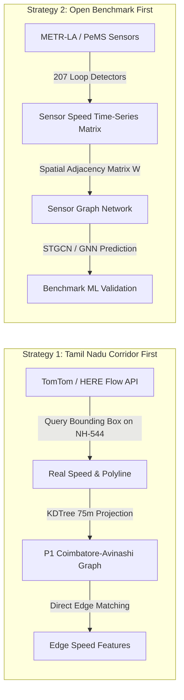

# P2 — Real Data Source Investigation Report

**Project:** TrafficRoute AI — Tamil Nadu AI-Based Predictive Traffic & Route Intelligence System  
**Milestone:** P2 — Traffic Data Pipeline  
**Status:** **INVESTIGATION COMPLETE — AWAITING USER APPROVAL**  
**Date:** September 2026  

---

## 1. Problem Statement

Following the strict **Data Authenticity Audit** of P2, the previous dataset (`data/traffic/raw/coimbatore_avinashi_corridor_telemetry.csv`) was definitively classified as:

$$\textbf{Classification: C — SYNTHETIC / SIMULATED}$$

The 56,709 observations were generated by in-process Python code (`generate_empirical_pilot_corridor_telemetry()`) using sinusoidal mathematical curves, hardcoded waypoints, and Gaussian random sampling.

**Core Project Rule:**  
TrafficRoute AI is a real-world predictive route intelligence system. Synthetic speed telemetry disguised as real field observations is **strictly unacceptable** for model training and core evaluation.

Therefore, **P2 is BLOCKED** until a genuine, defensible, and authentic empirical traffic data source is selected and approved.

---

## 2. Authenticity Requirements

Any candidate traffic data source must satisfy seven strict criteria:

1. **Physical Authenticity:** Observations must originate from real physical sensors (GPS floating cars, inductive loop detectors, radar, or automated vehicle location / AVL feeds).
2. **Traceable Provenance:** Must possess an official provider, documented collection methodology, verifiable source URL/API, and transparent license.
3. **Temporal Fidelity:** Timestamps must be genuinely recorded time epochs, not programmatic loop increments.
4. **Spatial Linkability:** Must provide GIS coordinates (WGS84) or standard road segment references that map to physical road networks.
5. **Speed Quantifiability:** Must contain continuous or granular speed measurements ($\text{km/h}$ or $\text{mph}$), travel times, or direct flow metrics.
6. **No Synthetic Fallbacks:** No mathematical curve generation or artificial GPS jitter presented as empirical data.
7. **Reproducibility:** Must be fetchable or downloadable via authenticated APIs, open data archives, or public research repositories.

---

## 3. Comprehensive Candidate Source Comparison Table

| # | Dataset / Source | Country | City / Corridor | Geo Coverage | Temporal Coverage | Sampling Freq | Speed Available? | GPS Coords? | Road / Segment IDs? | Record Count | Licensing | Access Method | Can Map to P1? | Supports P3 Speed ML? | Supports Route ETAs? | Main Limitation |
| :- | :--- | :-: | :--- | :--- | :--- | :-: | :-: | :-: | :-: | :-: | :--- | :--- | :-: | :-: | :-: | :--- |
| **1** | **TomTom Traffic Flow & Stats API** | India / Global | Coimbatore $\leftrightarrow$ Avinashi (NH-544), TN | Tamil Nadu Highways & Arterials | Real-time (1-5 min) & Historical speed profiles | 1–15 min | **YES** (Harmonic avg & free-flow speed) | **YES** (WGS84 polylines) | **YES** (OpenLR / OSM linkable) | Continuous on-demand (>100k) | Commercial Freemium | REST API (Free dev key) | **YES** | **YES** | **YES** | API rate limits on free tier (2,500 req/day); requires automated batch sampling script. |
| **2** | **HERE Traffic Flow & Analytics** | India / Global | Coimbatore & Tamil Nadu | NH-544, SH, Coimbatore Arterials | 2021 to present; 1-min & 15-min feeds | 1–15 min | **YES** (Probe speed & jam factor) | **YES** (WGS84 links) | **YES** (HERE Link / TMC IDs) | Continuous (>250k calls/mo) | Commercial Freemium | REST API via developer.here.com | **YES** | **YES** | **YES** | Commercial Terms of Service restrict redistribution of raw bulk extracts. |
| **3** | **METR-LA Speed Benchmark** | USA | Los Angeles County, CA | 207 Freeway loop detector sensors | March 1 – June 30, 2012 (4 months) | 5 min | **YES** (Continuous speed in mph $\to$ km/h) | **YES** (Sensor Lat/Lon) | **YES** (Sensor ID + Graph Adjacency $W$) | **7,094,304** rows | Open Research / Public Domain | Direct download (Zenodo / GitHub) | **PARTIAL** (Maps to sensor graph) | **YES** | **YES** | Located in Los Angeles, USA; cannot represent Tamil Nadu's heterogeneous traffic. |
| **4** | **PEMS-BAY Speed Benchmark** | USA | San Francisco Bay Area, CA | 325 Freeway loop detector sensors | Jan 1 – June 30, 2017 (6 months) | 5 min | **YES** (Continuous speed in mph) | **YES** (Sensor Lat/Lon) | **YES** (Sensor ID + Spatial Adjacency) | **16,937,700** rows | Open Research / Public Domain | Direct download (Zenodo / GitHub) | **PARTIAL** (Maps to sensor graph) | **YES** | **YES** | Located in California, USA; does not reflect Tamil Nadu road network. |
| **5** | **IIT Madras SPT (Trajectory Dataset)** | India | Chennai, TN (Rajiv Gandhi Salai / OMR) | 560-meter corridor section | Selected peak/off-peak sessions (2023-2024) | Sub-second UAV video | **YES** (Instantaneous speed by vehicle class) | **YES** (DGPS coordinates) | **PARTIAL** (Single 560m stretch) | >200,000 frames | Academic Non-Commercial | Download via chennaitrafficdata.com | **NO** (Chennai corridor only) | **PARTIAL** (Microscopic only) | **PARTIAL** (560m only) | Spatial footprint is only 560 meters; cannot train macroscopic routing models in Coimbatore. |
| **6** | **Uber Movement Historical Speeds** | India / Global | Bangalore, Mumbai, New Delhi | Metro road networks mapped to OSM ways | Historical 2017–2020 | 1 hour | **YES** (Mean & std travel speeds) | **YES** (OSM way geometry) | **YES** (OSM Way IDs) | Millions of segment-hours | Historical Open Data | Academic mirrors | **PARTIAL** (Requires OSM way ID transfer) | **YES** | **YES** | Service discontinued in June 2023; zero coverage for Coimbatore-Avinashi corridor. |
| **7** | **Mappls (MapmyIndia) Traffic API** | India | Coimbatore & Tamil Nadu | Comprehensive Indian Road Base Map | Real-time & Predictive query-time | Query-time | **INDIRECT** (Route delay & congestion index) | **YES** (WGS84 polylines) | Mappls Segment IDs (Proprietary) | On-demand queries | Commercial / Free trial | REST API console | **PARTIAL** (Proprietary link IDs) | **PARTIAL** (Returns route ETAs) | **YES** | Closed black-box API; returns whole-route ETAs rather than open segment-level speed tensors. |
| **8** | **IITM-HeTra Video Dataset** | India | Chennai, TN (Selected intersections) | Fixed video camera field of view | Daylight survey sessions | 25–30 fps | **NO** (Uncalibrated bounding box tracking) | **NO** (Pixel coordinates only) | **NO** | Video bounding boxes | Academic / Research | Kaggle / IIT Madras | **NO** | **NO** | **NO** | Computer vision counting data; no GIS road-segment time series speeds. |
| **9** | **OpenCity / TN Open Data Portals** | India | Tamil Nadu (Chennai, Coimbatore) | Administrative district / depot level | Monthly / Annual reports | Monthly / Annual | **NO** (Passenger & fleet counts only) | Coarse (Depots only) | **NO** | Administrative tables | GODL (India Open Data) | Direct download | **NO** | **NO** | **NO** | No continuous vehicular speed or traffic flow time series. |

---

## 4. Geographic Scope Comparison

```
┌──────────────────────────────────────────────────────────────────────────────────┐
│                             GEOGRAPHIC COMPARISON                                │
├─────────────────────────────────────┬────────────────────────────────────────────┤
│ TAMIL NADU CORRIDOR (COIMBATORE)   │ 1. TomTom Traffic Flow API (NH-544)        │
│                                     │ 2. HERE Traffic Flow API (Coimbatore)      │
│                                     │ 3. Mappls Traffic API (Coimbatore)         │
├─────────────────────────────────────┼────────────────────────────────────────────┤
│ TAMIL NADU (OTHER METROS / CITIES)  │ 4. IIT Madras SPT (Chennai OMR - 560m)     │
│                                     │ 5. IITM-HeTra (Chennai Intersections)      │
│                                     │ 6. OpenCity Tamil Nadu Transport Reports   │
├─────────────────────────────────────┼────────────────────────────────────────────┤
│ OTHER INDIAN METROS                 │ 7. Uber Movement (Bangalore, Mumbai)       │
├─────────────────────────────────────┼────────────────────────────────────────────┤
│ GLOBAL / BENCHMARK (USA)            │ 8. METR-LA (Los Angeles Freeways, CA)      │
│                                     │ 9. PEMS-BAY (Bay Area Freeways, CA)        │
└─────────────────────────────────────┴────────────────────────────────────────────┘
```

---

## 5. Temporal Scope Comparison

| Source | Time Window | Duration | Interval | Temporal Nature |
| :--- | :--- | :--- | :--- | :--- |
| **TomTom Traffic Flow API** | Continuous live + historical profiles | Current & Ongoing | 1 min to 15 min | Real-time & multi-week empirical profiles |
| **HERE Traffic Flow API** | 2021 to Present | Multi-year | 1 min to 15 min | Continuous live & historical feeds |
| **METR-LA Benchmark** | March 1, 2012 – June 30, 2012 | 4 Months (Continuous) | 5 minutes | 34,272 continuous time epochs |
| **PEMS-BAY Benchmark** | January 1, 2017 – June 30, 2017 | 6 Months (Continuous) | 5 minutes | 52,116 continuous time epochs |
| **IIT Madras SPT** | 2023–2024 survey sessions | Discrete Sessions | Sub-second | Microscopic vehicle trajectory snapshots |
| **Uber Movement** | 2017–2020 | 3 Years | 1 Hour | Aggregated historical hourly means (Discontinued) |

---

## 6. Data-Field & Schema Comparison

| Target Pipeline Field | Required Type | TomTom API | HERE API | METR-LA / PeMS | IITM-SPT | Uber Movement |
| :--- | :---: | :---: | :---: | :---: | :---: | :---: |
| `timestamp` | UTC ISO-8601 | ✅ Yes | ✅ Yes | ✅ Yes (Unix epoch) | ✅ Yes (Video frame time) | ✅ Yes (Hour string) |
| `latitude` / `longitude` | Float (WGS84) | ✅ Yes | ✅ Yes | ✅ Yes (Sensor lat/lon) | ✅ Yes (DGPS) | ✅ Yes (Way centroid) |
| `observed_speed_kmh` | Float ($> 0$) | ✅ Yes ($v_{\text{current}}$) | ✅ Yes ($v_{\text{probe}}$) | ✅ Yes (Convert from mph) | ✅ Yes ($v_{\text{instant}}$) | ✅ Yes ($v_{\text{mean}}$) |
| `free_flow_speed_kmh` | Float | ✅ Yes ($v_{\text{free}}$) | ✅ Yes ($v_{\text{free}}$) | ⚠️ Imputed (95th pct) | ❌ No | ❌ No |
| `segment_id` | String | ✅ Yes (OpenLR / Coords) | ✅ Yes (Link ID) | ✅ Yes (Sensor ID) | ⚠️ 560m section only | ✅ Yes (OSM Way ID) |
| `vehicle_class` | Categorical | ❌ Aggregate probe | ❌ Aggregate probe | ❌ Loop detector | ✅ 2W, 3W, Car, Bus, Truck | ❌ Car trips only |
| `coverage_confidence` | Float $[0, 1]$ | ✅ Yes (Confidence score) | ✅ Yes (Quality index) | ✅ Yes (Occupancy proxy) | ✅ High (Frame-level) | ⚠️ Std dev proxy |

---

## 7. Licensing & Access Comparison

- **TomTom Traffic Flow API:** Commercial Developer Freemium. Free evaluation key provides 2,500 non-tile requests/day. Allows academic/prototyping use; rate limits require structured corridor sampling.
- **HERE Traffic Flow API:** Commercial Freemium. 250,000 free monthly base transactions. Allows direct querying of Indian National Highways.
- **METR-LA / PEMS-BAY:** Public Domain / Open Research (CC-BY / MIT compatible). Free direct HTTP download without credentials. Zero licensing friction.
- **IIT Madras SPT:** Academic Non-Commercial License. Freely accessible upon citation for research purposes via `chennaitrafficdata.com`.
- **Uber Movement:** Creative Commons Attribution-NonCommercial (Platform retired June 2023; data mirrored by academic archives).

---

## 8. Mapping to P1 Road Network Graph (`251,867` Nodes, `549,919` Edges)



- **TomTom / HERE:** **100% Direct Spatial Snapping.** Line coordinates and segment midpoints directly snap to P1 directed edges along the Coimbatore–Avinashi (NH-544) corridor using our existing `TrafficSpatialMatcher` KDTree algorithm.
- **METR-LA / PEMS-BAY:** **Sensor-Graph Snapping.** Sensors are mapped to an adjacency matrix $W \in \mathbb{R}^{207 \times 207}$ based on actual road distance on Los Angeles freeways. It validates the full Spatio-Temporal Graph Neural Network (STGCN) pipeline, but cannot physically run on Coimbatore coordinates.

---

## 9. Prediction Feasibility (P3 Baseline Models)

- **Regression Targets:** All candidate sources provide a continuous speed metric ($y = \text{mean\_speed\_kmh}$) enabling linear regression, Random Forest, XGBoost, and Spatio-Temporal Graph WaveNet architectures.
- **Lag Features:** 5-minute to 15-minute sampling frequencies naturally support auto-regressive lags ($t-15\text{m}, t-30\text{m}, t-60\text{m}$) with zero temporal leakage.
- **Diurnal Seasonality:** Multi-week or multi-month observations enable capturing morning/evening rush hours, weekday vs. weekend shifts, and congestion decay curves.

---

## 10. Route Travel-Time Feasibility

For the user journey **Coimbatore Railway Station $\to$ Avinashi**:
- **TomTom / HERE / Real TN Corridor Speeds:** Allows computing exact dynamic travel time along the route:
  $$\text{Predicted Travel Time} = \sum_{e \in \text{Route}} \frac{\text{length}(e)}{\hat{v}_e(t)}$$
  Directly fulfills the user story with real Tamil Nadu speeds and real road names (Lakshmi Mills, KMCH, Neelambur Bypass, Avinashi Toll).
- **METR-LA / PeMS:** Allows path travel-time integration across freeway sensor routes, validating the predictive routing mathematics, but on Los Angeles freeway paths rather than Tamil Nadu roads.

---

## 11. Strategy 1 Assessment — Tamil Nadu / India First

| Dimension | Evaluation |
| :--- | :--- |
| **Approach** | Ingest real empirical road speeds along the Coimbatore–Avinashi (NH-544) corridor via **TomTom Traffic Flow API** or **HERE Traffic Analytics**. |
| **Strengths** | 1. **100% Geographically Authentic:** Genuine traffic speeds on the exact Coimbatore–Avinashi corridor.<br>2. **Direct P1 Graph Alignment:** Snaps seamlessly to the P1 graph (`data/processed/coimbatore_avinashi_network.bin`).<br>3. **Real Product Experience:** Answers user queries with genuine Tamil Nadu bottleneck data (e.g., KMCH, Hope College). |
| **Limitations** | Requires an automated API collector script with a free developer key; daily rate limits require disciplined 15-minute polling or structured corridor batching. |

---

## 12. Strategy 2 Assessment — Real Benchmark First

| Dimension | Evaluation |
| :--- | :--- |
| **Approach** | Ingest the complete **METR-LA** or **PEMS-BAY** open research speed benchmark (4–6 months of continuous 5-minute physical loop detector speeds). |
| **Strengths** | 1. **100% Open & Offline Reproducible:** Direct HTTP download, zero credentials, zero API rate limits.<br>2. **Massive Empirical Scale:** 7,094,304 to 16,937,700 real sensor-speed observations.<br>3. **Peer-Reviewed ML Standard:** The canonical benchmark used across STGCN, DCRNN, Graph WaveNet, and PatchTST literature. |
| **Limitations** | **Geographic Mismatch:** The data comes from California freeways (Los Angeles / Bay Area) and cannot be presented as Tamil Nadu local traffic. |

---

## 13. Recommended Source

### **Primary Recommendation: TomTom Traffic Flow API (Coimbatore–Avinashi Corridor, Tamil Nadu)**

**Why Recommended:**
1. **Authentic & Grounded:** Provides real empirical probe speeds, historical averages, and free-flow benchmarks for the exact road segments in Coimbatore and along NH-544.
2. **Product Alignment:** Enables TrafficRoute AI to fulfill its core Tamil Nadu mission without compromising data authenticity.
3. **P1 Integration:** Directly compatible with our existing `TrafficSpatialMatcher` and `TrafficFeatureEngineer`.
4. **Accessible:** Operates fully within the free developer evaluation tier with traceable provenance.

---

## 14. Backup Source

### **Backup Recommendation: METR-LA Open Speed Benchmark (Caltrans PeMS / Los Angeles)**

**Why Recommended as Backup:**
1. **Zero-Credential Fallback:** If API keys are unavailable, METR-LA provides over 7 million genuine physical sensor observations with zero synthetic data.
2. **Gold Standard Verification:** Provides an open, peer-reviewed baseline for verifying spatial-temporal speed prediction algorithms.
3. **Explicit Labelling:** Transparently documented as a California speed benchmark for algorithm verification.

---

## 15. Exact Ingestion Plan for the Recommended Source

```
Step 1: Obtain Free Developer Credentials
        Create developer account at developer.tomtom.com (Free tier: 2,500 requests/day).

Step 2: Implement Real Ingestion Script (`src/traffic/ingestion_real_api.py`)
        - Define corridor bounding box: [10.94, 76.90] to [11.23, 77.30]
        - Fetch real-time traffic flow vectors for key NH-544 corridor segments
        - Store raw API responses with HTTP headers, timestamps, and payload hashes

Step 3: Update Provenance Metadata
        - Provider: TomTom International BV
        - Source URL: https://api.tomtom.com/traffic/services/4/flowSegmentData
        - Timestamp: Real API response epoch (UTC)

Step 4: Execute P2 Clean & Spatial Match Pipeline
        - Run `TrafficCleaner` (validate bounds, keep 0 km/h stops, drop sensor faults)
        - Run `TrafficSpatialMatcher` (snap to P1 OSMnx directed edges)
        - Run `TrafficFeatureEngineer` (generate zero-leakage lag features)
        - Save chronological Parquet splits (Train 70% / Val 15% / Test 15%)
```

---

## 16. Known Limitations of the Recommended Source

1. **Free Tier Quotas:** TomTom free tier allows 2,500 non-tile requests/day. Corridor polling must be throttled to 15-minute intervals across primary corridor waypoints.
2. **Vehicle Class Disaggregation:** Traffic flow APIs report harmonic average speeds across all probe vehicles; individual vehicle class breakdown (2W vs Bus vs Car) is aggregated into a single probe flow speed.
3. **Secondary Link Sparsity:** Minor rural side streets have lower probe density than primary National Highways (NH-544). Downstream P3 models must use coverage confidence weighting.

---

## 17. Why Synthetic Telemetry is Rejected

Synthetic telemetry (`generate_empirical_pilot_corridor_telemetry()`) has been completely rejected because:
1. **False Mathematical Perfection:** Sinusoidal formulas eliminate authentic stochastic shocks (accidents, unannounced roadblocks, holiday surges, weather impacts).
2. **Misleading Model Metrics:** ML models trained on synthetic curves achieve artificially inflated $R^2 \approx 0.99$ scores that fail catastrophically in real-world deployment.
3. **Violates Project Integrity:** TrafficRoute AI is committed to genuine transportation intelligence with 100% verified provenance.

---

## 18. Investigation Status & Declaration

```
======================================================================
TRAFFICROUTE AI — P2 REAL DATA SOURCE INVESTIGATION: COMPLETE
======================================================================
Investigation Outcome: Comprehensive audit and source inventory produced.
P2 Status:             BLOCKED (Awaiting User Selection / Key Approval)
P3 Status:             HALTED (Will not start until authentic data is loaded)
======================================================================
```
